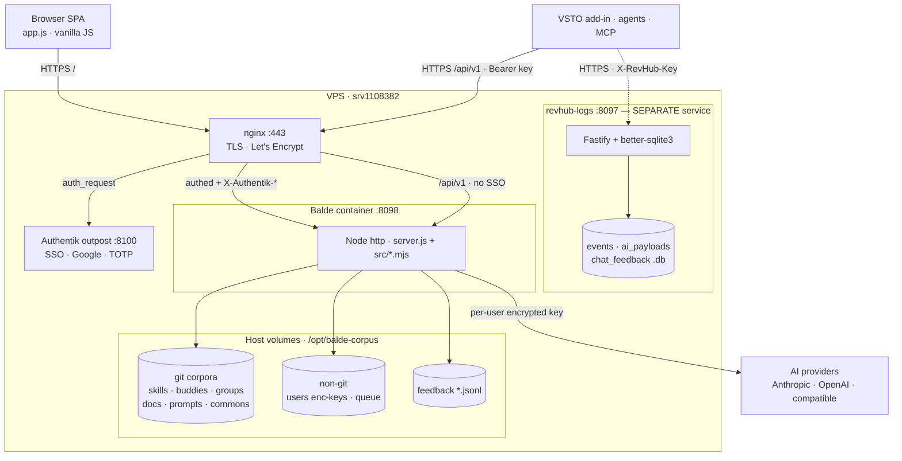
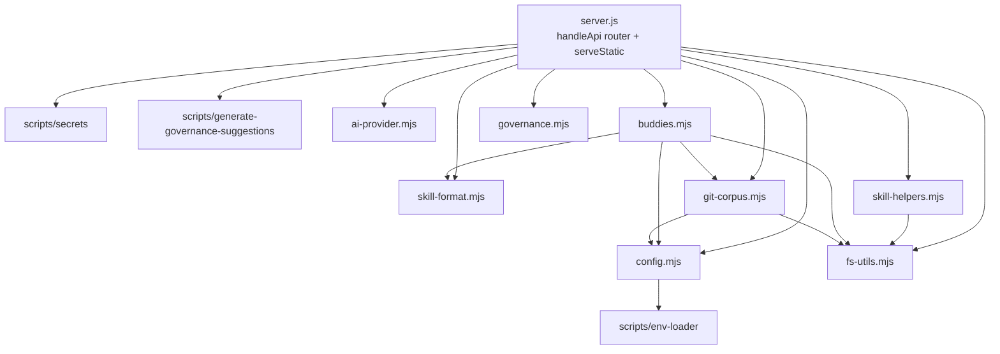
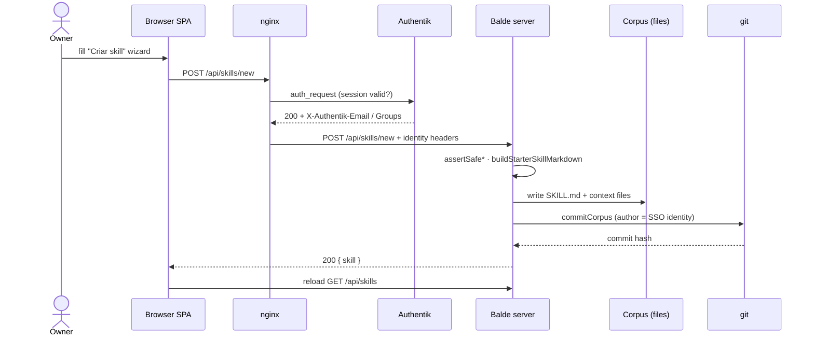
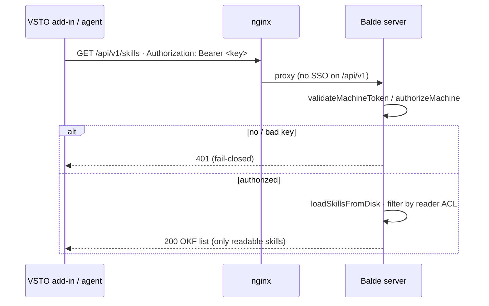

# Balde — System Map

Architecture, module, and request-flow diagrams for **Balde de conhecimento**
(the skills-governance cockpit). Zero-dependency Node HTTP server + vanilla-JS
SPA, deployed as a single Docker container behind nginx + Authentik SSO on the
VPS. Git is the version ledger for the corpus.

> Diagrams are Mermaid — they render on GitHub and in most Markdown previewers.

---

## 1. Deployment / container architecture

Who talks to whom across the network boundary. The **whole app** is gated by
Authentik SSO; the **machine API** (`/api/v1`) is carved out and authenticates by
key in the app itself. `revhub-logs` is a **separate** service (the VSTO add-in's
telemetry) and is *not* wired into Balde.

---

## 2. Backend module graph

The `src/*.mjs` modules extracted from `server.js` (modularization in progress).
Arrows = "imports". `config.mjs` and `fs-utils.mjs` are the shared leaves;
`governance.mjs` is self-contained (zero imports).

---

## 3. Sequence — create a skill (the git-as-ledger write path)

Balde's signature: every corpus write is a git commit authored by the SSO
identity nginx forwards. This is the same shape for edit / upload / publish.

---

## 4. Sequence — machine API fetch (fail-closed, key-authed)

External consumers read the OKF corpus with a Bearer key or personal token.
nginx sends `/api/v1` straight to the app (no Authentik); the app authorizes.

---

### Legend / notes

- **SSO gate**: `location /` → `auth_request` → Authentik outpost; anon → 302 to login.
- **Machine API**: `location /api/v1/` bypasses SSO; the app authenticates by key and is **fail-closed** (empty key set ⇒ API disabled).
- **Git ledger**: corpora under `/opt/balde-corpus/*` are git repos; every write commits with the SSO identity as author (`commitCorpus`).
- **Secrets**: per-user AI keys are encrypted at rest (`ai-key.enc.json`, `BALDE_SECRET_KEY`); machine keys live in `env_file` outside the deploy dir.
- **Not wired**: `revhub-logs` (SQLite telemetry) receives the VSTO add-in's events directly; it is not connected to Balde's flat-file feedback.
